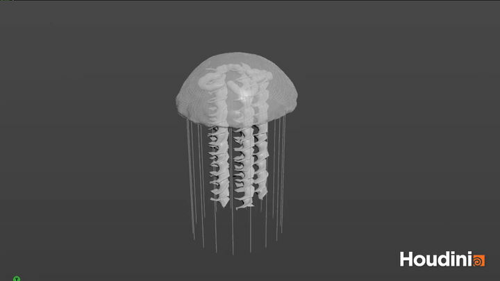

# Procedural Jellyfish

## Bell

A Line defines the side profile. Two Bend nodes shape and animate it, then Revolve turns the profile into a bell. A Wrangle and Mountain add folds and surface variation, and PolyExtrude gives the shell thickness.

## Veins

TimeShift freezes the bell at frame 1. Remesh and Find Shortest Path create vein curves on this fixed surface. I did the animation follow differently because point deform looks good when I changed the bell's transform only but If I change the bends it doesn't follow that well. So I alternatively uses Ray to record where each curve point lands on the frozen bell (`hitprim` and `hitprimuv`). Attribute Interpolate uses those locations on the current animated bell, so the veins follow its Bend deformation. Sweep gives the curves width.

## Arms

A Grid is displaced with sine waves and noise to make ruffles, then twisted, remeshed, and copied around the center. Point Deform makes the arms follow the bell. Vellum cloth and pin constraints add secondary motion, while PolyExtrude gives the simulated surfaces thickness.

## Organ

A resampled Line is bent into a U-shaped curve. Vellum hair and pin constraints animate it; PolyWire turns the curve into a tube. Wrangles taper its ends and add small waves, then Copy and Point Deform place four organs under the moving bell.

## Hair

A Line is copied to sampled points along the bell's lower rim. Vellum hair constraints let the strands sway while pin constraints hold their roots to the bell. PolyWire gives the simulated strands visible thickness.

## Extra Credit: Scalloped Bell Edges and Puckering

The Bell's Point Wrangle reads the rim and cap heights from the profile line connected to its second input. For each point, it uses the angle around the vertical axis to create a noisy sine wave that pushes the surface inward and outward. A height-based weight fades this displacement toward the top, so the scallops and puckering are strongest near the lower edge.
